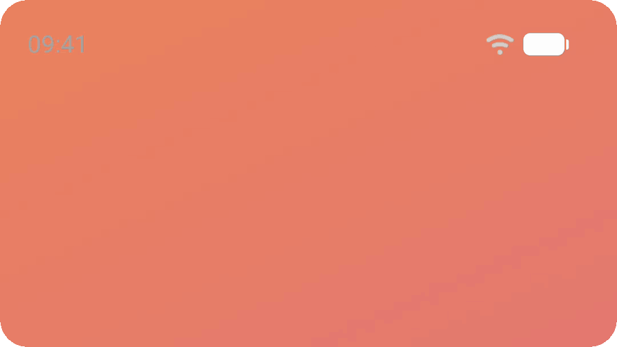

# Compose System Bars

Set status bar and navigation bar icon colors from Compose Multiplatform. Each screen declares the icons it needs. The library applies them on Android and iOS, and brings back the previous ones when the screen leaves.

[](https://central.sonatype.com/artifact/com.composables/systembars)
[](https://github.com/composablehorizons/systembars/actions/workflows/ci.yml)
[](LICENSE)

## Features

- **Multiplatform.** Update the system bars on Android and iOS with the same API.
- **Declarative.** A screen states the icons it needs. When it leaves composition, the previous request applies again.
- **Overlays stack.** The most recent request wins, so a sheet, viewer or dialog can change the icons and hand them back when it closes, including during navigation transitions.
- **Per-bar control.** Style both bars at once or each separately. A bar you leave unspecified keeps whatever is underneath.
- **Dialogs use their own window** on Android, so icons set inside a dialog do not change the screen behind it.
- **Preview and test friendly.** Collect requests into a state object and draw or check them yourself.

## Installation

Add the library to `commonMain`. It is published to Maven Central:

```kotlin
kotlin {
    sourceSets {
        commonMain.dependencies {
            implementation("com.composables:systembars:1.0.0")
        }
    }
}
```

## Quick start

Make the status and navigation bar icons dark by passing `SystemBarContent.Dark` to the `SystemBars()` composable:

```kotlin
import com.composables.systembars.SystemBarContent
import com.composables.systembars.SystemBars

@Composable
fun HomeScreen() {
    SystemBars(SystemBarContent.Dark)
    // Your UI
}
```

`SystemBarContent` sets the color of everything drawn on a bar: its icons, text and handle. `Dark` is for light backgrounds behind the bar, `Light` is for dark ones.

## iOS setup

iOS does not let an app set the status bar icon color directly, the way Android does. Instead, UIKit asks the `UIViewController` on screen for its `preferredStatusBarStyle`. The library needs a reference to that view controller so it can update the icons. Without one, `SystemBars` has no effect on iOS.

There are two ways to provide it:

### Use the SystemBarsViewController

If your app does not need its own view controller, host your Compose content in `SystemBarsViewController` instead of `ComposeUIViewController`:

```kotlin
import com.composables.systembars.SystemBarsViewController

fun MainViewController() = SystemBarsViewController {
    App()
}
```

### Use your own UIViewController

If you already have a view controller, or another library provides one, create a `SystemBarsState` for it, return its `statusBarStyle` from `preferredStatusBarStyle()`, and provide the state to your Compose content. The state tells the controller to update whenever the requested icons change:

```kotlin
@OptIn(ExperimentalForeignApi::class)
class AppViewController : UIViewController(null, null) {
    private val systemBarsState = SystemBarsState(this)

    override fun preferredStatusBarStyle() = systemBarsState.statusBarStyle

    override fun viewDidLoad() {
        super.viewDidLoad()
        val compose = ComposeUIViewController {
            ProvideSystemBars(systemBarsState) { App() }
        }
        addChildViewController(compose)
        view.addSubview(compose.view)
        compose.view.setFrame(view.bounds)
        compose.view.autoresizingMask = UIViewAutoresizingFlexibleWidth or UIViewAutoresizingFlexibleHeight
        compose.didMoveToParentViewController(this)
    }
}
```

## Examples

### Change the status bar icon color

Make the status bar icons white, for example over a dark header image, by passing `SystemBarContent.Light` as `statusBar`. The navigation bar stays as it is:

```kotlin
SystemBars(statusBar = SystemBarContent.Light)
```

### Change the navigation bar icon color

Make the navigation bar icons dark, for example over a light bottom bar, by passing `SystemBarContent.Dark` as `navigationBar`. The status bar stays as it is:

```kotlin
SystemBars(navigationBar = SystemBarContent.Dark)
```

This works on Android 8.0 (API 26) and later. Earlier versions always draw white navigation buttons, so the library leaves their navigation bar untouched. On iOS, the home indicator adapts its color to the content behind it automatically.

### Use different colors for the status and navigation bars

Make the status bar icons white and the navigation bar icons dark by passing both to `SystemBars()`:

```kotlin
SystemBars(statusBar = SystemBarContent.Light, navigationBar = SystemBarContent.Dark)
```

### Change the icon colors for a specific screen

Make the icons white only while a photo viewer is open, and dark again when it closes, by calling `SystemBars()` inside the viewer:

```kotlin
@Composable
fun Gallery() {
    SystemBars(SystemBarContent.Dark)
    var viewing by remember { mutableStateOf<Photo?>(null) }

    PhotoGrid(onClick = { viewing = it })

    viewing?.let { photo ->
        SystemBars(SystemBarContent.Light)
        PhotoViewer(photo, onClose = { viewing = null })
    }
}
```

### Change the status bar icon color from an overlay

Make only the status bar icons white while a dark banner is showing, and keep the screen's dark navigation bar icons, by leaving `navigationBar` unspecified in the banner. Each bar comes from the most recent request that specifies it:

```kotlin
SystemBars(SystemBarContent.Dark)                    // screen: both bars dark

if (showBanner) {
    SystemBars(statusBar = SystemBarContent.Light)   // overlay: status bar light, navigation bar stays dark
    DarkBanner()
}
```

### Show the system bars in previews and tests

Draw mock system bars in previews, design tools or tests by wrapping your content in `ProvideSystemBars()` and reading the requested icons from its `SystemBarsState`. Nothing is applied to the platform inside it:

```kotlin
val systemBarsState = remember { SystemBarsState() }
ProvideSystemBars(systemBarsState) {
    App()
}
FakeStatusBar(icons = systemBarsState.appearance.statusBar)
```

## Platform notes

- **Android:** requests apply to the hosting Activity or dialog window. On Android 8.0 and later, the navigation bar is transparent while a request is active. When the last request leaves, the original appearance returns.
- **iOS:** only the status bar is styled. iOS updates the home indicator automatically.

## Troubleshooting

- **Icons do not change on Android.** `SystemBars` needs an Activity or dialog window. Elsewhere, such as in a service overlay, it does nothing and logs a warning once. Previews skip the warning.
- **Icons are invisible.** Choose the content for the background behind the bar, not for the system theme: `Light` on dark backgrounds, `Dark` on light ones.
- **Icons do not change on iOS.** Host Compose with `SystemBarsViewController`, or create a `SystemBarsState(viewController)` and return its `statusBarStyle` from that controller. Without a host, `SystemBars` does nothing and logs a warning once.
